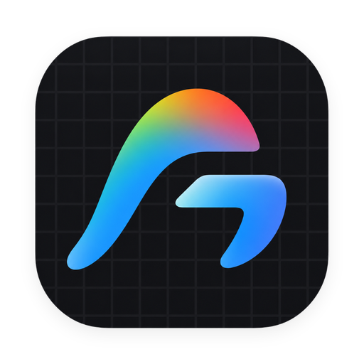
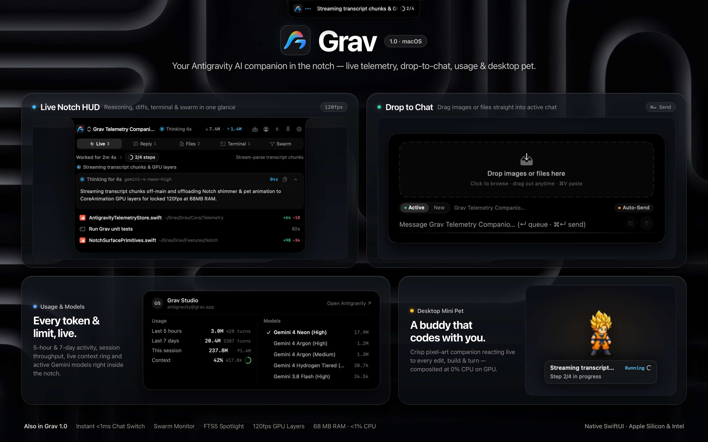

<div align="center">



# Grav

A lightweight native macOS notch companion for **Google Antigravity**.

<p>
  
  
  
  
  <a href="LICENSE"></a>
</p>

<p>
  <a href="#what-it-does">Features</a> ·
  <a href="#shortcuts">Shortcuts</a> ·
  <a href="#build-from-source">Build from Source</a> ·
  <a href="CONTRIBUTING.md">Contributing</a>
</p>

<br />



</div>

<br />

Grav sits in your MacBook notch (or as a minimal top pill on external monitors) and shows what Antigravity is doing right now—without switching windows. Everything is read locally from Antigravity's runtime files, stays under ~70 MB of RAM, and idles near 0% CPU.

## What it does

- **Live Notch HUD** — Watch reasoning, streamed replies, file diffs (`+added / -removed`), terminal output, and swarm agents in real time. Switching between chats hits an in-memory LRU cache in under a millisecond.
- **Drop to Chat** — Drag screenshots or files straight up to the notch to open the drop shelf, type a prompt, and send it directly into your active Antigravity session (or spin up a new chat).
- **Usage & Models** — Check 5-hour and 7-day activity, session token counts, live context window fill, and active Gemini models right from the notch.
- **Desktop Mini Pet** — An optional pixel-art buddy on your desktop that reacts to builds, edits, and thinking turns, composited directly on the GPU via CoreAnimation.
- **Built to stay out of your way** — Event-driven `kqueue` file watchers, read-only SQLite WAL inspection, FTS5 Spotlight search across past chats, and GPU-offloaded animations for locked 120Hz ProMotion.

## Shortcuts

| Shortcut | Action |
| :--- | :--- |
| `⌥ Space` | Toggle Notch HUD |
| `1` – `5` | Switch between Live, Reply, Files, Terminal, and Swarm tabs |
| `⌘ [` / `⌘ ]` | Cycle recent Antigravity chats |
| `⌘ D` | Open Drop Shelf & Prompt Composer |
| `⌘ U` | Open Usage & Models drawer |
| `⌘ C` | Copy active reply, diff, or command output |
| `⌘ L` | Pin or unpin the notch |
| `Esc` | Close drawer or collapse notch |

## Build from source

Requires **macOS 14.0+** and **Xcode 16+** (Swift 6).

```bash
# Clone the repo
git clone https://github.com/williamcachamwri/Grav.git
cd Grav

# Build Debug (Apple Silicon)
xcodebuild -project Grav.xcodeproj -scheme Grav -configuration Debug -destination 'platform=macOS,arch=arm64' build

# Build Universal Release (arm64 + x86_64)
xcodebuild -project Grav.xcodeproj -scheme Grav -configuration Release ARCHS="arm64 x86_64" ONLY_ACTIVE_ARCH=NO build

# Run unit tests
xcodebuild -project Grav.xcodeproj -scheme Grav -configuration Debug test
```

If you edit `project.yml`, regenerate the Xcode project with `xcodegen generate`.

> **Note on Active-Chat Send:** Sending prompts straight into your currently open Antigravity session uses macOS Accessibility (`CGEvent`) to paste and submit cleanly. When prompted, grant Grav permission in **System Settings → Privacy & Security → Accessibility**. Signing locally with a consistent Apple Development certificate keeps that permission across rebuilds.

## Privacy & local-only design

Grav reads local session files under `~/.gemini/antigravity/` (transcripts, task logs, annotations, and read-only SQLite WAL snapshots). It never uploads your prompts, code, or usage data anywhere.

## Contributing

Bug reports, ideas, and pull requests are welcome. Read [CONTRIBUTING.md](CONTRIBUTING.md) before opening a PR.

## License

Grav is released under the [MIT License](LICENSE). Built with [NotchKit](https://github.com/duongductrong/NotchKit).
